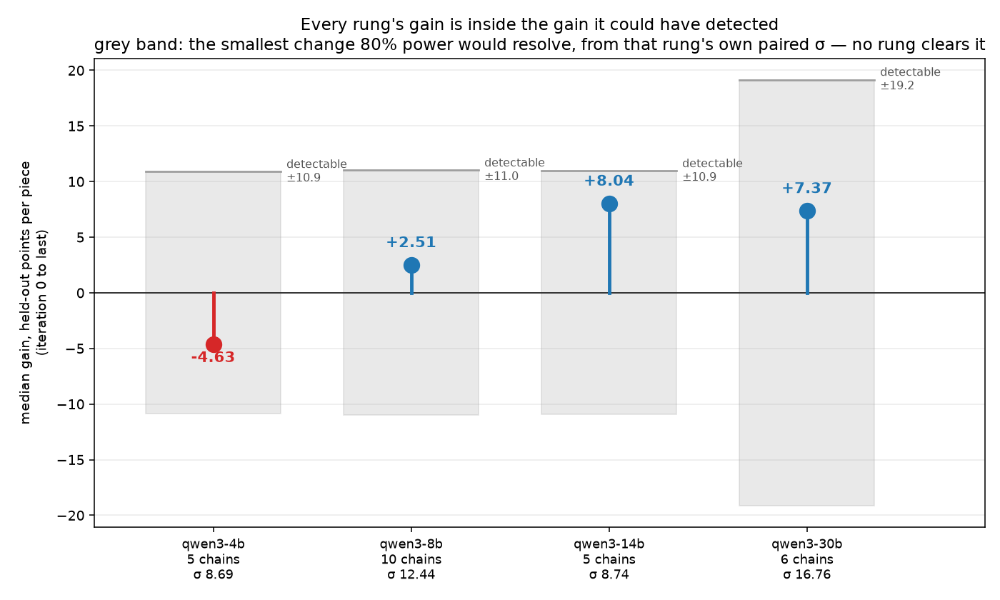
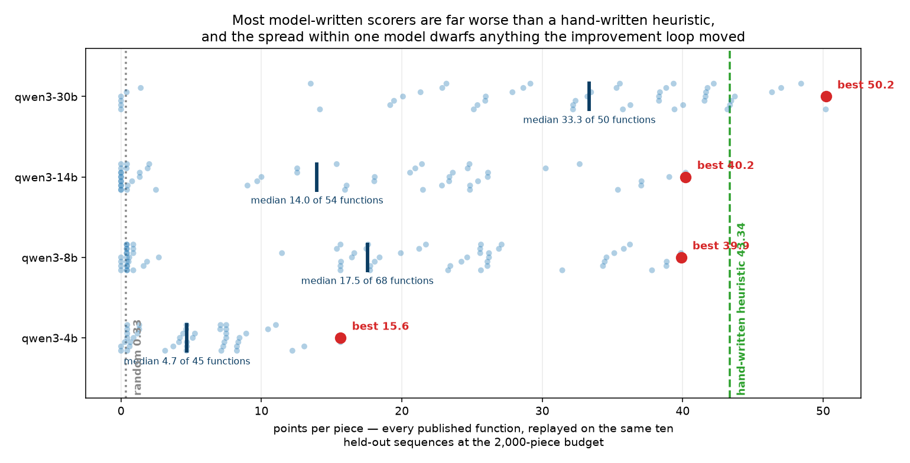

# tetris-bench

**Do LLMs get better at a task when you tell them how they did and let them try
again?** This benchmark measures that directly, on Tetris, across four model
sizes.

The short answer, on the evidence here, is **no — and what happens instead is
the interesting part.**

## How it works

The model never picks a move. Once per attempt it writes a Python function:

```python
def score(board, placement) -> float: ...
```

The engine applies that function to every legal placement and plays the
highest-scoring one. So a whole 2,000-piece game costs **one** model call, and
the thing being measured is the *function* rather than any single move.

One attempt is called an **iteration**. After each one the model is shown what
happened — score, holes, stack height, how the game ended, a few board
snapshots — and asked to revise its function. Six iterations make a **chain**,
and several independent chains run per model, each revising only its own
function so that a rising median cannot be an artifact of picking winners.

Four properties make the numbers mean something:

| | |
|---|---|
| **Held-out seeds** | The model sees outcomes on piece sequences `1, 2, 17`. Every number in this README is measured on sequences `1000-1009`, which it never sees. |
| **Independent chains** | No chain sees another's function, and nothing is selected as "best so far". |
| **Measured noise** | Two runs of the identical prompt disagree enormously. Each model's own spread is measured, and no gain counts until it clears it. |
| **Sandboxed execution** | Model-written code runs in a separate interpreter under `python -I`, behind an AST allowlist, with a time limit on every call. |

[Full design notes](docs/design.md) · [architecture diagram](docs/design.md#architecture)

## Results



Points per piece, four model sizes, one byte-identical prompt, six iterations
each.

| model | chains | median start | **median change per chain** | detectable at that sample size |
|---|---:|---:|---:|---:|
| `qwen3-4b` | 5 | 7.49 | **−4.63** | ±10.88 |
| `qwen3-8b` | 10 | 15.63 | **+2.51** | ±11.02 |
| `qwen3-14b` | 5 | 12.55 | **+8.04** | ±10.95 |
| `qwen3-30b` | 6 | 38.57 | **+7.37** | ±19.16 |

The change column is the **median of each chain's own first-to-last
difference** — not the difference between medians, which is a different number
because different chains are the median at each end.

**The reference players, measured under the identical conditions** — the same
ten held-out sequences, the same 2,000-piece budget:

| | points per piece |
|---|---:|
| random play, pooled over 20 agent seeds | **0.33** |
| hand-written 1-ply heuristic (Lee's 2013 weights) | **43.3** |

Every comparison in this project uses those two numbers. Older write-ups quote
the heuristic at 43.2 or 43.5; those are the same player on twenty sequences and
run to exhaustion respectively, and the spread between all three is the honest
measure of how stable the rate is. The conditions now travel with the number —
see [`baselines.py`](src/tetris_bench/baselines.py).

**1. No model improved by more than its own noise.** Every gain above sits
inside the range that model's sample size could resolve, so each result is a
*bounded* null rather than a flat zero: an 8B gain of eleven points per piece or
more is ruled out, a gain of five is not addressed. Three other ways the loop
could have been improving something the curve cannot see — the mean, the share
of functions that can express a strategy, the share scoring nothing — were each
checked and each came back null.

**2. Most first attempts are broken code, not weak strategy.** 37 of 60 first
functions cannot express a strategy at all: they count the empty space above the
stack as holes, or compute a height term that is identically zero on every
board. A score cannot tell that apart from a bad idea, which is why the
benchmark probes each function on pairs of boards where the better one is not a
matter of opinion.

**3. The one apparent success was a repair, not a refinement.** The best
function here reaches 50.19 points per piece, above the hand-written heuristic.
It was written up as a model correctly reweighting its own terms — until a
replay showed its previous version had two *dead* terms, and that its new
weights applied to the unrepaired function are worth **−3.90**. Meanwhile 8 of
94 revisions rewrote their weights and then chose **identically** on every board
of ten full games; one of them doubled every weight, which cannot move an
argmax.

**Where the functions actually land.** Every published function replayed under
those same conditions, against the two reference players:



The spread inside a single model is far wider than anything the improvement loop
moved. 23 of the 217 playable functions score at or below random, and 7 beat
the hand-written heuristic — all 7 from the 30B. Median by model — 4.7, 17.5, 14.0, 33.3 —
rises with size but not monotonically, which is the same step-not-slope shape
the capability probes found.

[All results in full](docs/results.md) · [individual write-ups](docs/findings/)
· [raw logs and every generated function](runs/published/)

## Limitations

- **Power.** Each null is bounded at roughly ±11 points per piece (±19 for the
  30B). A real gain of five would not have been seen. Closing that costs 49
  chains, about six hours, on the 8B.
- **One model family, one quantisation, one machine.** Everything is Qwen3 at
  4-bit through Ollama on a 32 GB MacBook. Whether a frontier model improves is
  **untested**, and it is the first thing a reader should want to know.
- **The loop has one step of memory.** Each revision sees only the previous
  function and that attempt's outcome — never the attempts before it or how they
  scored. A model therefore cannot tell whether its last change helped, which
  may itself explain why it reweights rather than debugs. A history arm that
  shows the whole trajectory is implemented (`--history`) and **has not been
  run**; see [Related work](#related-work).
- **Six iterations, and five or six chains on three of the four models.** A
  slower effect over twenty iterations is not excluded.
- **One prompt.** Comparability across models was bought at the price of
  leaving prompt sensitivity unmeasured.
- **Size and architecture are confounded at the top.** The 30B is the only
  mixture-of-experts model, and it is the one that pulls ahead.

[The rest, including what would change these answers](docs/results.md#not-done)

## Related work

**[FunSearch](https://www.nature.com/articles/s41586-023-06924-6)** (DeepMind,
2024) also has an LLM write scoring functions that a harness evaluates, and it
produces genuinely better programs. The difference is the thing being measured:
FunSearch is a *search* — it samples many candidates and keeps the best, so the
improvement can come from selection rather than from the model. This benchmark
deliberately removes selection. Each chain carries its own single function
forward whether or not it got worse, because the question is whether **the model
improves itself**, not whether search finds a good function. The two designs
answer different questions, and the null here is not evidence against FunSearch.

**[Reflexion](https://arxiv.org/abs/2303.11366)** and
**[OPRO](https://arxiv.org/abs/2309.03409)** give a model its own history of
attempts and scores, which is exactly the single-step-memory limitation above.
That is the most informative experiment left here: if a history arm improves,
the null is a property of the feedback design; if it does not, the null is much
stronger.

**lmgame-Bench** (UCSD, 2025) covers Tetris among several games and found that
vision input hurts and a harness helps — both reasons this benchmark passes a
text grid and enumerates legal placements. **TetrisBench** (a16z, 2026) found
direct move-picking failed and that asking for a scoring function worked, which
is the design adopted here. Neither measures iterated self-improvement, which is
what this project adds.

## Install and run

Requires [uv](https://docs.astral.sh/uv/), which supplies Python itself.

```bash
git clone https://github.com/AlicanK-code/tetris-bench && cd tetris-bench && uv sync --all-extras
```

Use `--all-extras`: `uv sync --extra analysis` *uninstalls* the `llm` extra and
leaves the model client missing at import.

**Everything in this README reproduces without a model.** The logs and every
generated function are committed, and a saved function replays in under a
second:

```bash
uv run pytest
```

```bash
uv run python analysis/power_figure.py
```

To run a model, install [Ollama](https://ollama.com) and pull a rung — the 8B
is 5.2 GB and reproduces the main experiment:

```bash
ollama pull qwen3:8b
```

```bash
uv run tetris-bench loop --model qwen3-8b --chains 10 --iterations 6 --log runs/mine.jsonl
```

About 7 hours and 60 generations on an M-series laptop, and **resumable by
replay** — rerun the identical command and it skips completed positions. Full
instructions, including the one-shot and baseline commands, are in
[docs/design.md](docs/design.md#running-it).

## Where everything else is

| | |
|---|---|
| [docs/results.md](docs/results.md) | Every result in full, with the per-model curves. |
| [docs/design.md](docs/design.md) | Engine, agents, prompts, records, model client, sandbox. |
| [docs/findings/](docs/findings/) | One write-up per experiment, each reproducible from committed artifacts. |
| [docs/timeline.md](docs/timeline.md) | How it was built, and **28 published claims this project corrected with its own later measurement.** |
| [runs/published/](runs/published/) | The logs, all 229 generated functions, and the prompt and reasoning trace behind each. |

## Licence

[MIT](LICENSE). The heuristic baseline weights are from Yiyuan Lee's 2013 post,
credited in [Agent design notes](docs/design.md#agent-design-notes).
