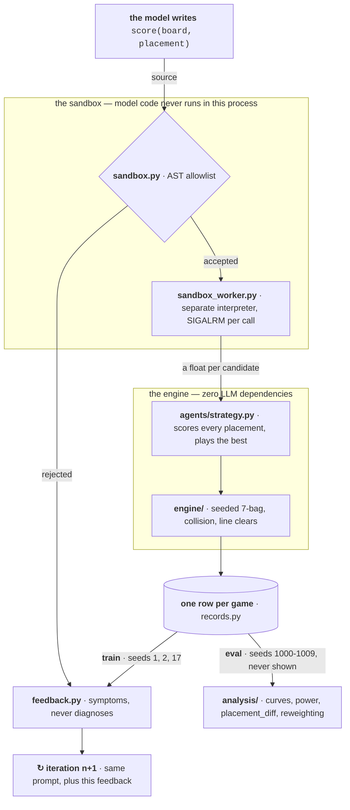

# Design notes

How the benchmark is built, and why each piece is the way it is. The
[README](../README.md) has the question and the results; this has the
machinery. Every heading below was part of the README until 2026-11-25, when
the front page was cut to something a reader can finish.

Paths are relative to the repository root, and every claim here is backed by a
test in [`tests/`](../tests/).

---

## Architecture

One loop, three layers, and a hard boundary in the middle. The model never
chooses a move: it writes a **scoring function**, and the engine applies that
function to every legal placement. That is what makes the benchmark cheap
enough to run thousands of games, and what makes the *function* -- rather than
any single move -- the thing being measured.



Four properties the diagram is drawn to make visible, because each one is load
bearing for whether a number here means anything:

| | |
|---|---|
| **The engine never imports LLM code** | `engine/` and `agents/` are pure and unit-tested. A bug in prompting cannot change what a game score means. |
| **Model code crosses a process boundary** | Two independent layers: an AST allowlist that rejects an import before anything runs, and a separate `python -I` interpreter with `SIGALRM` bounding every call. The function sees tuples and dicts -- no class, module or method of this project reaches it. |
| **Feedback is symptoms, not diagnoses** | The model is told what happened, never what to fix. Diagnosing its own bug is the ability being measured, so handing it the diagnosis would measure something else. |
| **Training and evaluation seeds are disjoint** | The model sees outcomes on seeds `1, 2, 17`. **Every curve in this README is read from seeds `1000-1009`, whose outcomes it never sees.** A function that overfits its feedback shows up as a gap between the two. |

A fuller tour is in [Engine design notes](#engine-design-notes),
[Agent design notes](#agent-design-notes) and [Model client](#model-client).

## Running it

Requires [uv](https://docs.astral.sh/uv/), which supplies Python itself (pinned
to 3.13 in `.python-version`). Everything below was run on an Apple Silicon
MacBook with 32 GB of unified memory.

```bash
git clone https://github.com/AlicanK-code/tetris-bench && cd tetris-bench
uv sync --all-extras
```

**Use `--all-extras`, not one extra at a time.** `uv sync` resolves the
environment to exactly what is asked for, so `uv sync --extra analysis`
*uninstalls* the `llm` extra and leaves the model client missing at import.
Both are needed on the same machine, because a run is played and then plotted.

### Step 1 — everything that needs no model at all

This is the part worth trying first, and it reproduces **every published number
in this README**. The artifacts are committed, so the analyses replay them
without inference:

```bash
uv run pytest                                   # 779 tests, about 50s
```

```bash
uv run tetris-bench play --agent heuristic --seed 1   # the reference player
```

```bash
uv run python analysis/curves.py --log runs/published/8b-loop/loop.jsonl
```

```bash
uv run python analysis/power_figure.py          # redraws the figure below
```

```bash
uv run python analysis/reweighting.py           # the term-level replay
```

A saved scoring function replays in well under a second, which is why the
findings are checkable: every claim links to a log and a function in
[`runs/published/`](../runs/published/), and each write-up ends with the commands
that regenerate its own numbers.

### Step 2 — running a model

Install [Ollama](https://ollama.com), then pull whichever rungs you want --
2.5, 5.2, 9.3 and 18 GB respectively, 35 GB for all four. The 8B alone
reproduces the main experiment:

```bash
ollama pull qwen3:8b
```

```bash
uv run tetris-bench models            # lists and validates configs/models.yaml
```

It reads the config and checks which models need an API key; it does not
contact Ollama. The first command that does is the one-shot run:

```bash
uv run tetris-bench strategy --model qwen3-8b --seed 1    # one function, one game
```

```bash
uv run tetris-bench loop --model qwen3-8b --chains 10 --iterations 6 --log runs/mine.jsonl
```

That last command is the experiment this README reports: ~7 hours and 60
generations on an M-series laptop. It is **resumable by replay** -- rerun the
identical command and it reads the log, skips completed positions, and
regenerates the feedback from saved functions in under a second each. Safe to
kill.

Model names, temperature, token caps and timeouts live in
[`configs/models.yaml`](../configs/models.yaml), identical across rungs on purpose:
a ladder comparison is only about model size if nothing else differs.

---

## Engine design notes

Three narrowings make the engine small and the benchmark sharper. All are
additive to undo later.

- **Hard-drop placements only.** A move is "rotate in free space, pick a column,
  drop straight down". No tucks or slides under an overhang. This keeps
  `legal_placements` a pure function of the board and short enough to show a
  model in a prompt, and keeps the measurement on *position scoring* rather than
  on spotting clever slides.
- **No SRS wall kicks, and deduplicated rotations.** Because a piece is never
  rotated against an obstruction, only the set of *distinct* shapes matters. So
  `O` has 1 rotation state, `I`/`S`/`Z` have 2, and `T`/`J`/`L` have 4. A
  rotation index is an index into that tuple and deliberately does not always
  match SRS numbering. The payoff is that a model is never offered the same move
  twice as if it were a real choice.
- **A piece budget, not a time limit.** A game ends on `block_out` (the next
  piece has nowhere to land) or `piece_limit`, default 2000. A competent
  heuristic stacks cleanly for a very long time -- the reference one averages
  10,467 pieces and varies by more than its own mean -- so without a cap a run
  takes an unpredictable length of time; capping pieces rather than wall-clock
  time also keeps every model's game the same length. The budget makes `score` a
  **censored** measure, which matters more than it sounds -- see
  [Reference baselines](#reference-baselines).

Line scores are the classic 100 / 300 / 500 / 800 for 1-4 rows, with no level
multiplier since there is no gravity to speed up.

## Reference baselines

Two reference players, on the 20 held-out seeds the improvement curve is read
from, at the default 2000-piece budget.

**On the ten sequences every model figure uses** (`1000-1009`, 2,000-piece
budget) — these are the numbers to compare a model against, and the ones
[`baselines.py`](../src/tetris_bench/baselines.py) publishes:

| agent | what it does | mean score | mean pieces | points/piece | censored |
|-------|--------------|-----------:|------------:|-------------:|---------:|
| random | uniform over legal placements, pooled over 20 agent seeds | 8.5 | 25.4 | **0.33** | 0/200 |
| heuristic | Lee's 2013 weights, 1-ply | 84,720 | 1,955 | **43.34** | 8/10 |

**On twenty sequences** (`1000-1019`, same budget), which earlier write-ups
quote:

| agent | what it does | mean score | mean pieces | points/piece | lines/piece | censored |
|-------|--------------|-----------:|------------:|-------------:|------------:|---------:|
| random | uniform over legal placements | 10 | 26 | 0.4 | 0.00 | 0/20 |
| heuristic | Lee's 2013 weights, 1-ply | 76,040 | 1,762 | **43.16** | **0.40** | 14/20 |

**The heuristic's total score is nearly unmeasurable, and that changes how
everything else gets quoted.** Run it to exhaustion -- a 50,000-piece budget,
where it dies on its own on all 20 seeds -- and it averages 454,900 points over
10,467 pieces with a standard deviation of **470,079**. A coefficient of
variation above 100% means a single game says almost nothing, and pinning the
mean to even 10% would take hundreds of games.

Its *rate*, meanwhile, is **43.46** points per piece run to exhaustion, and
holds between **43.16 and 43.46** across every budget and seed set tried: 500,
2,000, 20,000 and 50,000 pieces, on ten sequences and on twenty. One of these
two quantities is a usable comparator and the other is not.

That 0.3-point spread is also the answer to an obvious objection. The project
has quoted 43.2 and 43.5 in different places, and both were right — twenty
sequences at the default budget, and twenty run to exhaustion. Neither was
labelled, so a reader comparing a model's 50.19 against 43.5 could fairly ask
why the table said 43.2. The comparator is now fixed at **43.34**, the value
under the conditions model results are actually measured in, and
[`baselines.py`](../src/tetris_bench/baselines.py) carries all three rows with
their conditions.

At the 2000-piece budget runs actually use, the heuristic is censored on 14 of
20 seeds, so its total there is a lower bound and "beat 21,600" was really "beat
the 500-piece budget". A censored agent also looks *more* consistent than it is,
because the cap truncates exactly the games that would have run long -- which is
why the +/- 21,065 at the 2000-piece budget understates the +/- 470,079 that is
really there.

So the benchmark reports two separable things and declines to collapse them:

- **survival** -- does the agent die, and after how many pieces?
- **rate** -- points and lines per piece *while alive*, the only figure that
  survives a change of budget.

That separation is what makes the headline in [Results](results.md) legible: the
best model-written function reached 92% of the heuristic's *rate* while dying
after 626 pieces. Those are two different failures, and the ratio of two
truncated totals hid both.

```bash
uv run python analysis/baseline_ceiling.py
uv run python analysis/baseline_ceiling.py --max-pieces 20000 --seeds 5
uv run tetris-bench play --agent heuristic --seed 1
```

The random agent never clears a line on most seeds, which makes it a floor
rather than a competitor. Earlier revisions of this table carried a third
"naive" row -- drop each piece as deep as it will go, ~1,675 points. It is gone
because no such agent exists in the codebase, so the row could not be reproduced
from this repo; a few `analysis/` scripts still print the figure as a hardcoded
reference literal.

## Agent design notes

**The scoring function is the primitive, not the agent.**
`ScoringFunction = Callable[[Board, Placement], float]` rates one candidate move,
and `ScoringAgent` is a small adapter that applies a scorer to every legal
placement and keeps the best. The heuristic agent is `ScoringAgent` plus a
weighted sum of board features.

This matters for milestone 5. `strategy` mode asks a model to write exactly a
`score(board, placement) -> float` function, so a model-written scorer is the
same *kind* of object as the hand-written heuristic and the comparison is
apples-to-apples. `Agent` stays the general interface, since "choose uniformly at
random" is not a per-placement rating.

**`StrategyAgent` is a separate class, not a `ScoringAgent`.** Both follow "rate
every legal placement, keep the best", but they cannot share the adapter, because
the sandbox boundary changes the contract: the heuristic receives the pre-move
`Board` and calls `apply_placement` itself, whereas a sandboxed function is
handed the *post-move* board already flattened to tuples of bool plus a dict
carrying `lines_cleared`. Crossing a process boundary one placement at a time
would also be unaffordable, so `StrategyAgent` batches a whole piece's candidates
into one call. The duplication is real and deliberate; calling it "the same
adapter" would be wrong.

**Features are measured after the move, not before.** The heuristic scores the
board a placement *would produce*, once the piece is locked and any completed
rows are cleared. Scoring the current board would rate every candidate
identically, because the board is the same for all of them.

**Two independent seeds per run.** One for the piece sequence, one for the
agent's own randomness. The random agent owns its own `random.Random` instance:
sharing the game's piece RNG would let the agent's draws shift the piece
sequence, so two agents would face different games and the premise that every
model plays identical seeds would fail silently.

**Weights are a frozen dataclass**, defaulting to the values published by Yiyuan
Lee in ["Tetris AI - The (Near) Perfect
Bot"](https://codemyroad.wordpress.com/2013/04/14/tetris-ai-the-near-perfect-player/)
(2013), found with a genetic algorithm. They are used unmodified so the baseline
does not move. Note Lee tuned them for a 10x22 board with one lookahead piece, so
they are optimised for a near neighbour of this engine's rules rather than for it
exactly -- a reference ceiling, not a published optimum here.

## Prompt rendering

Everything a model reads is built in `render.py`, so the whole model-facing
surface sits in one reviewable file.

The board is 20 rows; the empty rows above the stack are trimmed here.

```
0123456789
..........
..........
##.......#
##......##
##.....###
#.#####.##

current piece   I
next pieces     Z S O L Z
score           2300
lines cleared   22
pieces placed   60
max height      4
holes           2
bumpiness       6
```

```bash
uv run tetris-bench play --seed 1 --max-pieces 60 --show-state
```

**A column index row sits above the grid.** A placement is named by rotation and
column, so a model can read the column number straight down rather than counting
cells, which is exactly the sort of thing it will get wrong.

**Filled cells are `#`, not the piece letter.** Tetris is Markovian in occupancy:
which placements are legal, which rows clear and what the board becomes next
depend only on whether a cell is filled, so the identity of the piece that filled
it cannot change the best move. The letters are not meaningless -- they show how
a stack was built -- but they are decision-irrelevant, and they cost tokens and
ask the model to treat seven symbols as equivalent. `--show-pieces` brings them
back for inspecting a game by hand; note that feedback snapshots do **not** use
it and always render `#`.

**A numbered list of legal moves exists but nothing currently consumes it.**
`render_placements` produces:

```
 0  rot=0 col=0 lands row 15
 1  rot=0 col=1 lands row 15
 2  rot=0 col=2 lands row 18
```

The intent was that choosing from a handed list cannot produce an illegal move,
whereas describing one freely can. That rationale belongs to `direct` mode, which
was [cut to a demonstration](results.md#not-done) -- so in the only live mode the model
writes a scoring function and never answers with an index. The renderer and its
tests are kept because the direct-agent demonstration still needs them.

**There is no hold piece.** Hold roughly doubles the branching factor per turn
for a benchmark about scoring-function quality, not move vocabulary.

## Run records

Two layers rather than one flat dataclass. `GameResult` is what a finished game
produced and knows nothing about models, so the baseline agents emit a complete
record with nothing left empty. `RunRecord` wraps one with the model-side facts
-- model, mode, iteration, and tokens, latency and cost. They flatten to a
single-level JSON object at write time, so the JSONL on disk loads straight into
a dataframe:

```json
{"agent": "heuristic", "agent_seed": null, "avg_bumpiness": 6.45, "avg_holes": 0.8,
 "avg_max_height": 3.65, "cause": "piece_limit", "final_aggregate_height": 22,
 "final_bumpiness": 6, "final_holes": 2, "final_max_height": 4, "lines_cleared": 22,
 "pieces_placed": 60, "score": 2300, "seed": 1}
```

```bash
uv run tetris-bench play --agent heuristic --seed 1 --log runs/baseline.jsonl
```

Averages are sampled after every placement rather than read off the final board,
because a game that ends tall may have been played low for most of its length,
and the reverse. JSONL rather than one JSON array because a run that crashes
leaves every completed game already on disk and readable.

## Model client

One OpenAI-compatible client serves local runtimes and cloud providers alike, so
the provider is configuration rather than code and swapping a 30B local model for
a frontier one is a config edit.

```bash
uv sync --all-extras
uv run tetris-bench models
```

```
name       provider  model          in $/M  out $/M  key
qwen3-4b   ollama    qwen3:4b       0       0        not needed
qwen3-8b   ollama    qwen3:8b       0       0        not needed
qwen3-14b  ollama    qwen3:14b      0       0        not needed
qwen3-30b  ollama    qwen3:30b-a3b  0       0        not needed
```

That command validates configuration without touching the network, and reports
whether each model's key is present -- the one setup mistake worth catching
before a run rather than during one. Everything live in the committed config is
local and free; a paid entry is kept commented out to document the shape.

**Known providers live in code, configs name one.** Ollama and LM Studio serve on
fixed localhost ports and need no credential, so a config entry says which
provider and which model and nothing that would be identical in every file.
`base_url` and `api_key_env` can still be overridden for a remote box or a
gateway.

**Pricing lives in the config.** Each entry declares dollars per million tokens;
local models declare zero. Since a run must be reproducible from its config and
seed list, and prices change, a cost logged months ago stays explainable by the
file that produced it.

**The code's temperature default is 0, and a seed is set -- but neither makes
generation reproducible.** Measured: two runs of a byte-identical prompt at
temperature 0 with a fixed seed produced different functions on the 4B and on the
30B, where the two scored 0 and 1,700. The seed is honoured, so sampling is not
the cause; floating-point non-associativity is, and no seed removes it.
Reproducibility is a property of the (model, prompt) pair and is measured per
rung -- see [docs/findings/](findings/). The engine itself is provably
deterministic; this is entirely model-side.

**Every configured rung overrides that default to `temperature: 0.7`, because
`--chains` does not work at 0.** Greedy decoding takes the argmax at every step
and never draws from the RNG, so a per-chain seed has no random number to index:
measured, three seeds at temperature 0 return one byte-identical generation, and
at 1.0 return three different ones. A multi-chain sweep at temperature 0
therefore draws **one** sample and pays N times for it -- which a five-chain run
discovered the expensive way, with four of its five chains byte-identical.

`temperature`, `frequency_penalty`, `max_tokens` and `max_retries` are
**identical on all four rungs** by design. Each was first added to the 14B alone
to fix a specific problem, and leaving them there would have confounded model
size with sampling configuration -- a 4B truncated at a different token budget
than the 14B looks worse for a reason that has nothing to do with being a 4B.
One consequence worth stating: the live configs set `max_retries: 0`, so the
retry machinery described below is exercised by the test suite rather than by any
run in `runs/`.

**Transient failures are retried in the client**, with exponential backoff capped
at 30s, so callers only handle *semantic* failures: output that will not parse, a
scoring function that will not compile. A dropped connection, a timeout, a rate
limit and a 5xx are retried; a bad key, a malformed request and a missing model
are not, because retrying those just burns time and quota.

**Retries are tallied apart from calls.** `model_calls` counts logical calls so
cost-per-call stays meaningful, `retries` records provider flakiness separately,
and `failed_calls` counts calls that never succeeded. Latency is wall-clock and so
includes time spent retrying, because that is what a run costs in time. A failed
call still updates the tally: a run's cost includes the calls that did not work.

**The transport is injected**, so every test runs with no network, no API key and
no local model. That matters because the code recording failures has to be
exercised on purpose rather than when a provider happens to be down.

**Cost is measured in tokens and seconds, not dollars.** Local inference is free,
so `estimated_cost_usd` reads zero on every run. It stays in the schema so a paid
model could be added without a migration, but tokens-per-point and
seconds-per-point are the figures that mean anything here -- tokens being the
hardware-independent one, and seconds being what you actually wait for.

Cloud providers go through their OpenAI-compatible endpoints, so adding one is a
config entry rather than new code. The benefit of the single path is that local
and hosted runs are directly comparable; the cost is that provider-specific
features are unavailable through a compatibility layer.

